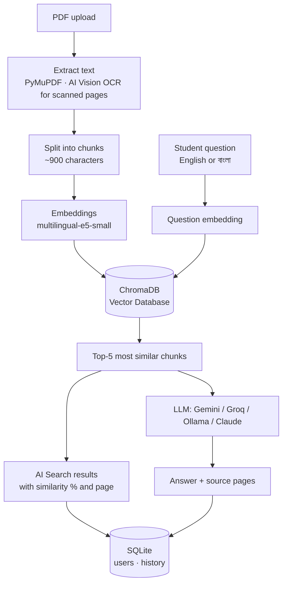

# 📚 StudyMate AI — Smart PDF Learning Assistant

Upload your lecture notes or books (PDF) and **read, search, ask questions, summarize, translate (English ⇄ বাংলা) and quiz yourself** — with answers that come **only from your own PDFs**, with page numbers.

> AI Engineering final project · Python · Streamlit · RAG · ChromaDB · SQLite
> 🇧🇩 বাংলায় setup গাইড: [README_BN.md](README_BN.md)

---

## ✅ Course requirements

| Requirement | Where in the app | Code |
|---|---|---|
| **AI Search** | 🔍 AI Search page — semantic search by meaning, with similarity % | `core/rag.py` |
| **AI Chatbot** | 💬 AI Chatbot page — answers from your PDFs with clickable source pages | `core/ai_features.py`, `core/llm.py` |
| **RAG / Vector Database** | PDF → chunks → embeddings → ChromaDB → top-k retrieval | `core/rag.py` |
| **Database Connection** | Users, upload history, chat/search history, notes, quiz scores (SQLite) | `core/database.py` |

## ✨ Features

- 🔐 **Login / Register** — passwords hashed with bcrypt
- 📁 **My Library** — upload several PDFs, upload history, delete
- 📖 **PDF Reader** — page navigation, zoom, remembers the last page, bookmarks, page notes
- 🔍 **Finder** — exact word search inside the PDF with yellow highlights
- 🧠 **AI Search** — finds text by meaning, compare with keyword search side by side
- 💬 **AI Chatbot (RAG)** — answers only from your PDFs, source pages, conversation memory, 👍👎 feedback
- 📝 **Summary** — whole PDF or a page range; short / detailed / bullet points
- 🌐 **Translator** — English ⇄ বাংলা, type text or load a PDF page
- 🧪 **Study Tools** — explain simply, word meaning, MCQ quiz generator with saved scores
- 👁️ **AI Vision** — reads scanned PDFs (OCR), explains diagrams on a page, 📷 Image AI for photos of notes
- 🔊 **Text to Speech** — listen to any answer (English and বাংলা)
- 🤖 **4 AI providers** — Google Gemini, Groq, Ollama, Anthropic Claude (switch in the sidebar)
- 🕘 **History & Dashboard** — everything is saved in the database

## 🏗️ How it works (RAG)



## 🛠️ Tech stack

Python 3.12 · Streamlit · PyMuPDF · sentence-transformers · ChromaDB · SQLite · bcrypt · Google Gemini API · Groq API · Ollama API · Anthropic Claude API · gTTS

## 🚀 Run it locally

**Requirements:** Python 3.12 and at least one free API key (Groq or Gemini).

```bash
# 1. Get the code
git clone https://github.com/<your-username>/StudyMate-AI.git
cd StudyMate-AI

# 2. Create a virtual environment and install packages
python3.12 -m venv .venv
source .venv/bin/activate          # Windows: .venv\Scripts\activate
pip install -r requirements.txt

# 3. Add your API keys
cp .env.example .env               # then open .env and paste your keys

# 4. Start the app
python run.py                      # or: streamlit run app.py
```

The app opens at **http://localhost:8501**. Register, log in, and upload a PDF from `sample_pdfs/` to try it.
The first upload downloads the embedding model (~470 MB) once.

### API keys

| Provider | Used for | Get a key | Cost |
|---|---|---|---|
| Groq | Chat, summary, quiz (high free limit) | https://console.groq.com/keys | Free |
| Google Gemini | AI Vision (images, scanned PDFs) + chat | https://aistudio.google.com/apikey | Free |
| Ollama Cloud | Optional alternative | https://ollama.com/settings/keys | Free plan |
| Anthropic Claude | Optional | https://console.anthropic.com/settings/keys | Paid |

Keys go in the `.env` file, which is listed in `.gitignore` and is **never uploaded**.

## 📂 Project structure

```
StudyMate-AI/
├── run.py               # start the app (PyCharm ▶ Run)
├── app.py               # Streamlit UI — all pages
├── config.py            # settings: providers, models, paths, chunk size
├── requirements.txt
├── .env.example         # API key template (copy to .env)
├── core/
│   ├── database.py      # Database connection (SQLite)
│   ├── rag.py           # RAG + vector DB + AI Search (ChromaDB)
│   ├── llm.py           # Gemini, Groq, Ollama, Claude (text + images)
│   ├── ai_features.py   # chatbot, summary, translation, quiz, vision prompts
│   ├── pdf_utils.py     # PDF text, page images, highlights, Finder
│   └── tts.py           # text to speech
├── sample_pdfs/         # demo PDFs (normal + scanned)
└── data/                # created at runtime (not in git)
```

## 🗄️ Database tables

`users` · `documents` · `reading_progress` · `bookmarks` · `notes` · `chat_history` · `search_history` · `summaries` · `translations` · `quiz_results` · `ocr_pages` · `vision_history`

## ⚠️ Limitations

- Needs internet for the AI providers; free plans have per-minute and per-day limits.
- Most Groq and Ollama models cannot read images, so AI Vision uses Gemini or Claude.
- Runs locally for one computer; it is not deployed as a public website.

## 👤 Author

**Md Juburaj Al Saba** — AI Engineering final project, 2026

## 📄 License

[MIT](LICENSE)
